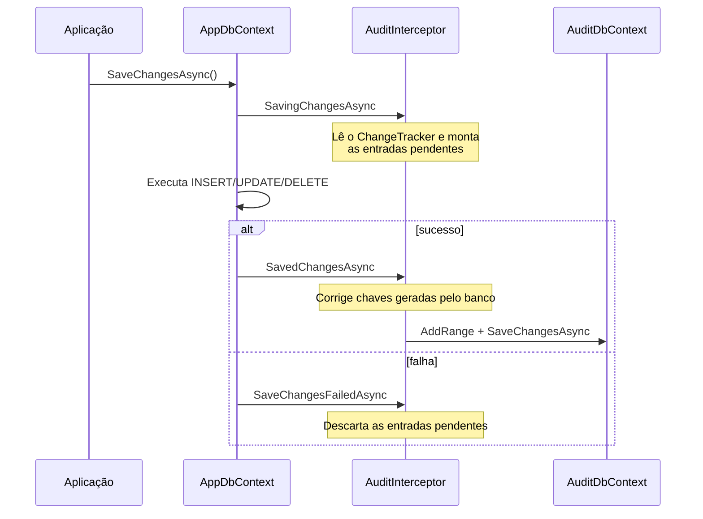

# Como funciona

## Estrutura da solução

```text
AuditLogCM.Core      Modelos e contratos, sem dependência de EF Core
  ├── Models/AuditEntry.cs
  ├── Enums/AuditAction.cs
  ├── Interfaces/ICurrentUserResolver.cs, IAuditSerializer.cs
  ├── Configuration/AuditOptions.cs
  └── Attributes/AuditIgnoreAttribute.cs
AuditLogCM.EFCore    Integração com o EF Core
  ├── Interceptors/AuditInterceptor.cs
  ├── Persistence/AuditDbContext.cs
  ├── Serializers/JsonAuditSerializer.cs
  └── Extensions/AuditLogExtensions.cs   AddAuditLog / UseAuditLog
AuditLogCM.Tests     Testes com xUnit
```

O `Core` não conhece o EF Core. Isso deixa os contratos reutilizáveis caso outro provedor de persistência
seja adicionado no futuro. Cada projeto é publicado como um pacote NuGet separado por um workflow do
GitHub Actions a cada push na `main`.

## Ciclo de vida do interceptor

O `AuditInterceptor` herda de `SaveChangesInterceptor` e atua em três momentos do `SaveChanges`:



### 1. `SavingChanges`: captura

Antes de o EF Core enviar os comandos ao banco, o interceptor percorre o `ChangeTracker` e, para cada
entidade `Added`, `Modified` ou `Deleted` que não esteja em `Ignorar<T>()`:

- Lê os **valores originais** (`OriginalValues`) em `Update` e `Delete`.
- Lê os **valores atuais** (`CurrentValues`) em `Create` e `Update`.
- Remove as propriedades marcadas com `[AuditIgnore]`.
- Monta um `AuditEntry` e guarda em uma lista de pendentes.

Nada é gravado ainda. Esse é o único momento em que os valores originais ainda estão disponíveis.

### 2. `SavedChanges`: gravação

Depois que o `SaveChanges` principal termina com sucesso, o interceptor grava as entradas pendentes no
`AuditDbContext`.

Antes disso ele resolve um detalhe: entidades novas com chave `IDENTITY` tinham uma **chave temporária**
no momento da captura. O interceptor guarda uma referência a essas entradas e, depois do `INSERT`,
relê a chave real e os valores finais.

### 3. `SaveChangesFailed`: descarte

Se o `SaveChanges` principal falhar, a lista de pendentes é descartada. Isso evita registros de auditoria
de alterações que nunca aconteceram.

## Decisões e limitações

- **Contexto separado para auditoria.** Usar um `AuditDbContext` próprio evita que as entradas de auditoria
  disparem o próprio interceptor e permite gravar a auditoria em outro banco. A contrapartida é que as duas
  gravações não estão na mesma transação: se a gravação da auditoria falhar depois que a operação principal
  já foi confirmada, o erro é registrado no log e propagado para o chamador.
- **Escopo do interceptor.** O interceptor é registrado como `Scoped`, então a lista de pendentes é isolada
  por requisição.
- **Valores como texto.** Os valores originais são convertidos para `string` antes de serializar, para que o
  JSON seja estável independentemente do tipo da coluna.

Para entender a motivação e as alternativas consideradas, leia o artigo
[Auditoria automática com interceptor do EF Core](/blog/auditoria-automatica-ef-core-interceptor/).
