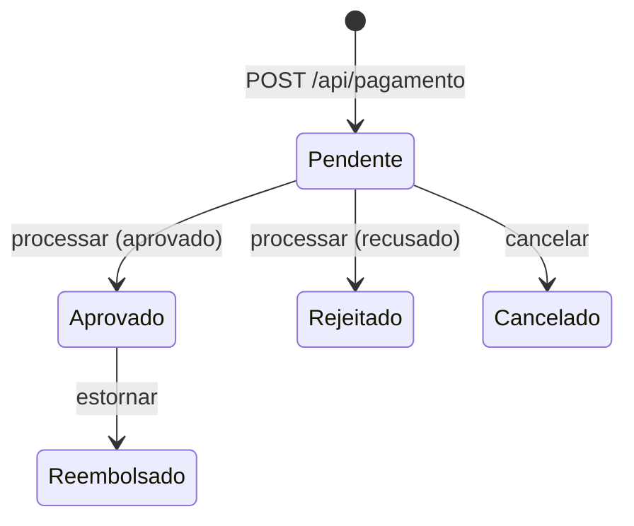

O **CMPay** é uma API REST de gateway de pagamentos em ASP.NET Core. Ela gerencia clientes, endereços,
cartões e pagamentos por Pix, cartão de crédito e cartão de débito.

É um projeto de estudo: o objetivo é praticar as decisões que um gateway real exige além do CRUD, como
**idempotência**, **autenticação entre sistemas**, **rastreabilidade** e **regras de transição de estado**.

> **Código-fonte:** [github.com/ClaudioMatheusDev/CMPay](https://github.com/ClaudioMatheusDev/CMPay)

## Stack

| Camada | Tecnologias |
| --- | --- |
| API | .NET 9, ASP.NET Core Web API, OpenAPI |
| Dados | Entity Framework Core 9, SQL Server |
| Observabilidade | Serilog, Correlation ID, health check |
| Testes | xUnit, Moq |
| Configuração | DotNetEnv (`.env`) |

## Arquitetura

A solução é dividida em camadas, e as dependências apontam para o domínio:

```text
CMPay.API              Controllers, middlewares, autenticação, Program.cs
CMPay.Application      Serviços (regras de negócio), DTOs, interfaces, exceções, validações
CMPay.Domain           Entidades e enums
CMPay.Infrastructure   AppDbContext, migrations, repositórios, processador de pagamento
CMPay.Tests            Testes unitários dos serviços
```

A `Application` define as interfaces dos repositórios e do processador de pagamento, e a `Infrastructure`
as implementa. Assim as regras de negócio são testáveis sem banco: os testes usam Moq no lugar dos repositórios.

## Ciclo de vida de um pagamento



Cada transição gera uma **transação** (`Pagamento`, `Cancelamento` ou `Reembolso`) com status e mensagem,
que pode ser consultada em `GET /api/pagamento/{id}/detalhes`. Transições inválidas, como estornar um
pagamento pendente, retornam `400`.

Ao criar o pagamento, a API calcula a taxa pelo método de pagamento e grava os valores bruto, taxa e líquido:

| Método | Taxa |
| --- | --- |
| Pix | 1% |
| Cartão de débito | 2% |
| Cartão de crédito | 3% |

O processador de pagamento atual é um simulador: aprova valores até 1.000 e recusa os maiores. Ele fica atrás
da interface `IProcessadorPagamento`, então pode ser trocado por uma integração real sem mexer no serviço.

## Observabilidade

- **Logs estruturados:** Serilog grava em console e em arquivo diário, com log de cada requisição.
- **Correlation ID:** toda requisição recebe ou propaga o header `X-Correlation-Id`, que aparece em todos os logs daquela requisição.
- **Health check:** `GET /health` verifica a conexão com o banco.
- **Erros padronizados:** um middleware global converte exceções de negócio em respostas JSON (veja [API](/projetos/cmpay/api/)).

## Como rodar

**Pré-requisitos:** .NET 9 SDK e SQL Server (ou LocalDB).

1. Crie um arquivo `.env` em `CMPay.API` com a connection string:

   ```text
   ConnectionStrings__DefaultConnection="Server=(localdb)\MSSQLLocalDB;Database=PayCM;Trusted_Connection=True;TrustServerCertificate=True;"
   ```

2. Aplique as migrations (ou defina `APPLY_MIGRATIONS=true` para aplicar na inicialização):

   ```bash
   dotnet ef database update --project CMPay.Infrastructure --startup-project CMPay.API
   ```

3. Rode a API e os testes:

   ```bash
   dotnet run --project CMPay.API
   dotnet test
   ```

Os testes cobrem `ClienteService`, `PagamentoService` (incluindo replay e conflito de idempotência),
`CartaoService` e `EnderecoService`.
